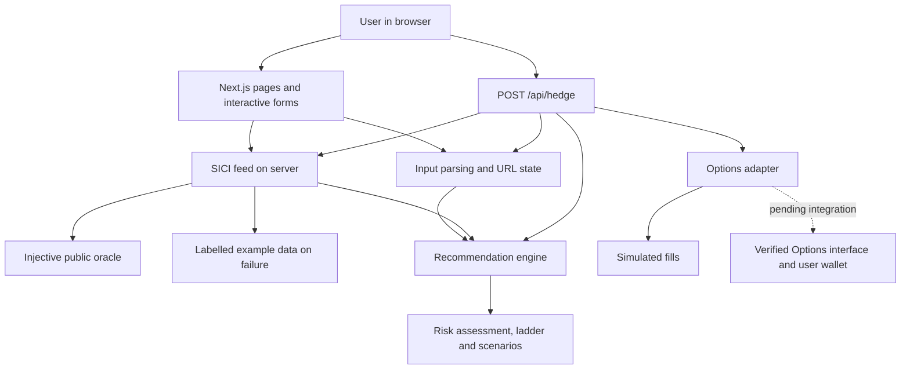

# gIA architecture

## Purpose and implementation status

gIA is a prototype for teams exposed to rising GPU rental costs. It translates
monthly spending and GPU mix into an illustrative ladder of capped calls on the
Super Intelligence Compute Index (SICI), then explains estimated premiums,
maximum payouts, and basis risk.

The application combines a React interface with a server-side recommendation
flow in one Next.js deployment. The reference price can come from a real oracle;
pricing, series selection, and fills remain a simulation.

| Capability | Current implementation | Required for real execution |
| --- | --- | --- |
| SICI reference | Public oracle with freshness checks and example-data fallback | Confirm compatibility with the selected option's settlement rules |
| Position design | Calculated strikes, caps, quantities, and monthly target expiries | Match actual listed series and trading increments |
| Premium | Indicative mathematical model | Executable, size-aware liquidity-provider quote |
| Execution | Mock fills, no transaction hash | Wallet signature, broadcast, fill and position confirmation |
| Renewal | Rollover policy preview | Verified permissions, budget limits, scheduling and recovery |
| History | No persistent storage | Position and transaction history with reconciliation |

## System boundaries



The browser does not receive a signing key. Oracle calls use a fixed list of
public URLs on the server. Selecting a mainnet reference source only changes
read-only market data; it does not enable mainnet transactions.

## Application structure

| Location | Responsibility |
| --- | --- |
| `app/` | Routes, server rendering, API handlers and global layout |
| `components/` | Input controls, reference provenance, risk badges, charts and simulated results |
| `lib/params.ts` | Query-string encoding, decoding and validation |
| `lib/sici.ts` | Index weights, methodology, shared types and fixture |
| `lib/sici-feed.ts` | Live oracle lookup, validation and fallback |
| `lib/basis.ts` | Mix normalization, basket divergence and stress scenarios |
| `lib/pricing.ts` | Indicative capped-call premium and payoff calculations |
| `lib/recommend.ts` | Position sizing, profiles and monthly ladder |
| `lib/adapter/` | Adapter interface, mock implementation and unavailable real implementation |
| `lib/rollover.ts` | Proposed renewal policy and disabled implementation |
| `tests/` | Domain, feed and API checks |
| `scripts/validate-markets.py` | Optional read-only inspection of public markets, oracle and testnet USDC |

The stack is Next.js App Router, React, TypeScript, and Tailwind CSS with
PostCSS. Development and production builds use Webpack. Vitest handles automated
checks. Google Fonts supplies the display, body and monospace fonts, with system
font fallbacks. There is no separate backend service or database.

## User flow and rendering

1. `/` introduces the product and streams the current reference through a
   Suspense boundary.
2. `/start` collects monthly USD spend, GPU mix, provider and coverage horizon.
3. `/recommendation` reads the URL, fetches a reference, and calculates the ladder,
   basis assessment, payoff chart and what-if scenarios on the server.
4. `/execute` previews the budget, current reference, adapter status and renewal
   policy. The simulation button is available for the mock adapter.
5. Clicking the button posts inputs to `/api/hedge`. The server parses them again,
   fetches a new reference and recomputes the recommendation before producing fills.

Interactive forms, clipboard actions and the simulation button are client
components. Oracle requests and API handlers run on the server. The shared
`SiciReference` component presents the source, observation time and simulation
status consistently.

A shared URL preserves inputs, not a fixed price or quote. Opening it later can
produce different results because the reference and target expiry dates are
recomputed. The simulation response includes the reference actually used so
changes since the preview remain visible. The application does not poll the feed
continuously or subscribe to a stream.

## Inputs and URL state

`lib/params.ts` represents a recommendation using these query parameters:

| Parameter | Meaning |
| --- | --- |
| `spend` | Positive monthly USD spend, at most 1 billion |
| `mix` | Chip shares, such as `h100:60,h200:40` |
| `h` | Horizon of 1, 3 or 6 months; otherwise defaults to 3 |
| `profile` | `tight`, `balanced` or `budget`; otherwise defaults to balanced |
| `hr` | Percentage of spending to hedge, above 0 through 100; otherwise defaults to 100 |
| `prov` | Optional provider label, trimmed and limited to 60 characters |

Only known chip keys with positive finite shares are decoded. Shares are
normalized into fractions before calculation. Mix serialization rounds shares
to one decimal percentage point; shared links therefore have limited precision.

There are no user accounts, saved recommendations or stored positions. Spend,
mix and provider appear in the URL and can be exposed when the link is shared
or captured in browser or infrastructure logs. Do not include confidential
identifiers in these fields.

## SICI reference pipeline

The modeled basket uses H100 40%, B200 25%, H200 15%, A100 10%, and RTX 4090 10%.
The methodology recorded in the project rebases each chip to 100 at the
22 July 2026 fixing, combines the fixed weights, and publishes a trailing
seven-day average. The daily fixing is 19:00 UTC.

`getSiciPrint()` defaults to the testnet `provider_prices` endpoint. Mainnet can
be selected explicitly for read-only reference data. The feed:

1. Requests JSON with `cache: no-store` and a four-second timeout.
2. Selects provider `InjectiveLabs` and exact symbol `SICI/USDC`.
3. Accepts a positive finite decimal-string price and a valid integer-string
   Unix timestamp.
4. Rejects observations older than two hours or more than one minute ahead of
   the server clock.
5. Chooses the newest valid observation if duplicates exist.
6. Returns decimal index points without applying the market mark-price scale.

A successful print has `source: live`, `level`, `asOf`, `network` and a provenance
note. Transport errors, bad HTTP responses, malformed JSON, invalid configuration,
and unacceptable observations yield the 113-point fixture with `source: fixture`.
`fallbackReason` is `disabled` in explicit fixture mode or `unavailable` otherwise.
No previous successful observation is persisted as a fallback.

`GET /api/sici` returns this reference with `Cache-Control: no-store`. A fallback
is a successful HTTP response containing explicitly labelled example data;
consumers must inspect `source`, not just the HTTP status. Server time must be
accurate for freshness checks to work.

The oracle observation is not an executable options quote. Its relationship to
the fixing used by a real option must be verified before settlement-sensitive use.

## Recommendation model

Let `B` be monthly spending, `r` the fraction hedged, `S0` the reference level,
and `m = 0.01` the assumed USD payout multiplier per index point per contract.
The model sizes each monthly leg as:

```text
contracts = round(r × B / (m × S0))
```

This approximates the slope of spending under the assumption that the bill moves
proportionally with SICI. For example, a $10,000 monthly bill at 113 points and a
100% hedge produces 8,850 contracts per monthly leg. This is a model result,
not confirmation that such a quantity or contract is available.

| Profile | Target strike above S0 | Target cap above S0 |
| --- | --- | --- |
| Tight | 0% | 20% |
| Balanced | 5% | 30% |
| Budget | 10% | 40% |

Strikes and caps are rounded to integer points, with the cap at least one point
above the strike. The engine creates one leg per month, using target dates at
19:00 UTC. These dates are calculated with JavaScript UTC month arithmetic;
month-end overflow is possible. Neither dates nor strikes are resolved against
a real series registry yet.

At settlement level `S`, each leg's modeled payout is:

```text
payout = min(max(S − strike, 0), cap − strike) × m × contracts
net result = payout − premium
```

The premium model prices a call spread with Black-76, using the reference as a
forward proxy, zero interest rates, assumed annual volatility of 45%, and a 10%
loading. Premiums are rounded to $0.001 per contract and bounded by maximum
payout. Tenor is approximated as the leg's month number divided by 12, rather
than exact day count. All of these assumptions need replacement or calibration
before actual trading. The `0.01` multiplier also needs verification against the
selected real series.

## Basis risk and scenario limits

`lib/basis.ts` compares the normalized GPU mix with the basket using total
variation distance: half the sum of absolute weight differences. Divergence
below 0.1 is low, below 0.3 is moderate, and otherwise high. A mix within 0.02
is marked close to the basket, without implying zero risk.

The report also measures tracked spend, weight overlap, and isolated 20% shocks
to each chip. Those stress ratios describe basket exposure, not the actual
option payout after strike, cap and premium. Provider labels add explanatory
context; they do not retrieve provider-specific prices or calibrate a hedge.
The chart and what-if table illustrate one monthly leg, not a full-path simulation
of GPU usage and every month's settlement.

## Simulation API and execution boundary

`POST /api/hedge` accepts JSON of the form:

```json
{ "query": "spend=10000&mix=h100:100&h=3&profile=balanced&hr=100" }
```

Malformed JSON or invalid spending/mix returns HTTP 400. The server does not
trust browser-submitted strike or premium values: it recalculates them from the
inputs and a newly obtained reference.

`OptionsAdapter` defines `status()`, `quote()` and `place()`. The default mock
quotes the model's own premium and returns one simulated fill per leg. Every fill
has `simulated: true`, a `SIM-` identifier and `txHash: null`. Collateral figures
are illustrative: no funds are locked. Successful responses include `status`,
`fills` and `sici` and disable caching. Adapter failures currently return HTTP 501.

`GIA_ADAPTER=injective` selects an unavailable implementation: status remains
not live and quote/place throw. It cannot enable trading. The current handler
places legs sequentially; a future implementation would need explicit handling
of partial fills, retries, idempotency and reconciliation before using that flow
for real orders.

## Intended path to real Options integration

A real implementation would add the following verified boundaries:

1. **Discovery:** query deployed Options contracts or messages and listed SICI
   series, including strike, cap, expiry, multiplier, increments and settlement token.
2. **Selection:** map the modeled budget to available series, exposing differences
   from the user's requested horizon and risk profile.
3. **Quotation:** obtain size-aware premiums, fees, available quantity and quote
   expiry. Require review when terms change; reject stale quotes or excess slippage.
4. **Signing:** prepare an order for the user's wallet, verify network and required
   token permissions, and request a signature without server key custody.
5. **Confirmation:** broadcast, observe actual fills, and reconcile the resulting
   position with the chain. A transaction submission alone is not a fill.
6. **Lifecycle:** persist relevant identifiers, track expiry and settlement, and
   expose failures and partially completed ladders to the user.

The current prototype does not implement these steps. A SICI perpetual market
ID and legacy Binary Options messages cannot substitute for a capped-call series.
Availability, access requirements and settlement semantics must be confirmed
with the actual Options deployment rather than inferred from an announcement.

## Proposed automatic renewal

`lib/rollover.ts` constructs a policy preview with a default trigger three days
before expiry, a maximum premium derived from the modeled legs, and a grant expiry
based on the final leg. Wallet addresses and message types are unset;
`enableAutoRoll()` always returns `enabled: false`.

The intended design uses scoped Cosmos AuthZ grants, execution and revocation if
the verified Options interface supports them. It still requires a decision on
the agent's signing and operations model. A generic message-type grant does not
itself impose a USDC spending limit. Real renewal would require enforceable
budgets, quote limits, revocation, scheduling and recovery from missed or failed
rolls. There is no scheduler, active grant or agent key in this prototype.

## Configuration and development

Use Node.js compatible with the pinned Next.js version and pnpm 12.16.1. The optional
Python validation script requires Python 3.11+ and HTTPS access. No API key is
needed for the default public feed. `package.json` pins pnpm through its
`packageManager` field. Commit `pnpm-lock.yaml` and use
`pnpm install --frozen-lockfile` in CI. `pnpm-workspace.yaml` retains a
24-hour minimum release age and verifies the lockfile. It lists exact-version
exceptions for the pinned Next.js 16.4.6 family, Rolldown 1.2.18 family and
Vite 8.3.7 so a clean deployment can install them during their initial release
window. These exceptions do not cover future versions and can be removed after
the window has elapsed.

Copy `.env.example` to `.env.local` to override defaults, then restart the server.

| Variable | Values | Default |
| --- | --- | --- |
| `GIA_SICI_MODE` | `live`, `fixture` | `live` |
| `GIA_SICI_NETWORK` | `testnet`, `mainnet` for read-only data | `testnet` |
| `GIA_ADAPTER` | `mock`, or unavailable `injective` implementation | `mock` |

For deterministic offline demonstrations use `GIA_SICI_MODE=fixture`. The feed
accepts only its fixed endpoints; there is no browser-controlled URL override.

```bash
pnpm dev              # Development server on port 3000
pnpm test             # Domain, feed and API checks
pnpm lint
pnpm typecheck
pnpm build            # Production build using Webpack
pnpm start            # Serve the production build
```

Tests cover basket weights, pricing, sizing, shared URL inputs, basis risk,
simulated fills, oracle parsing and freshness, fallback behavior and API results.
Network-facing automated tests use controlled responses. Optional
`python3 scripts/validate-markets.py` queries public endpoints and records a dated
local snapshot; it does not prove executable liquidity or future availability.

A Node.js server deployment is required for live reference reads and the
simulation API. A static-only export would not provide these handlers. Production
trading would additionally need authenticated position access, durable storage,
monitoring, request limits, transaction recovery and a reviewed execution model.

## Documentation and repository policy

`README.md` presents the product. This file records the architecture, current
limitations and intended implementation. Both belong in version control, along
with source code, runtime configuration, tests and the non-secret `.env.example`.

Local agent instructions (`AGENTS.md`, overrides and `CLAUDE.md`), workspace
configuration directories, validation research under `docs/validation/`, and the
internal `options-integration.md` request are ignored. They can remain on a local
workspace but are not dependencies of the application or its public documentation.
Environment files containing actual values and generated build artifacts remain
ignored. Ignoring a tracked file does not remove its past versions from Git.
